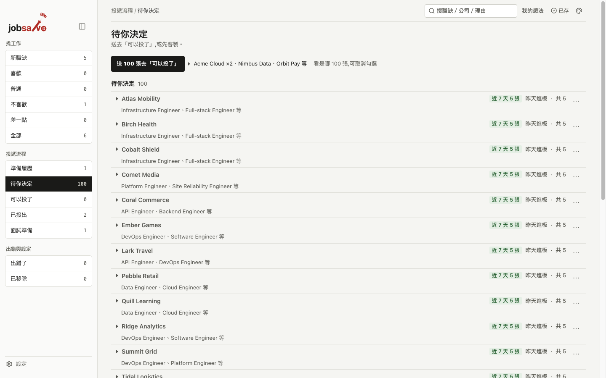
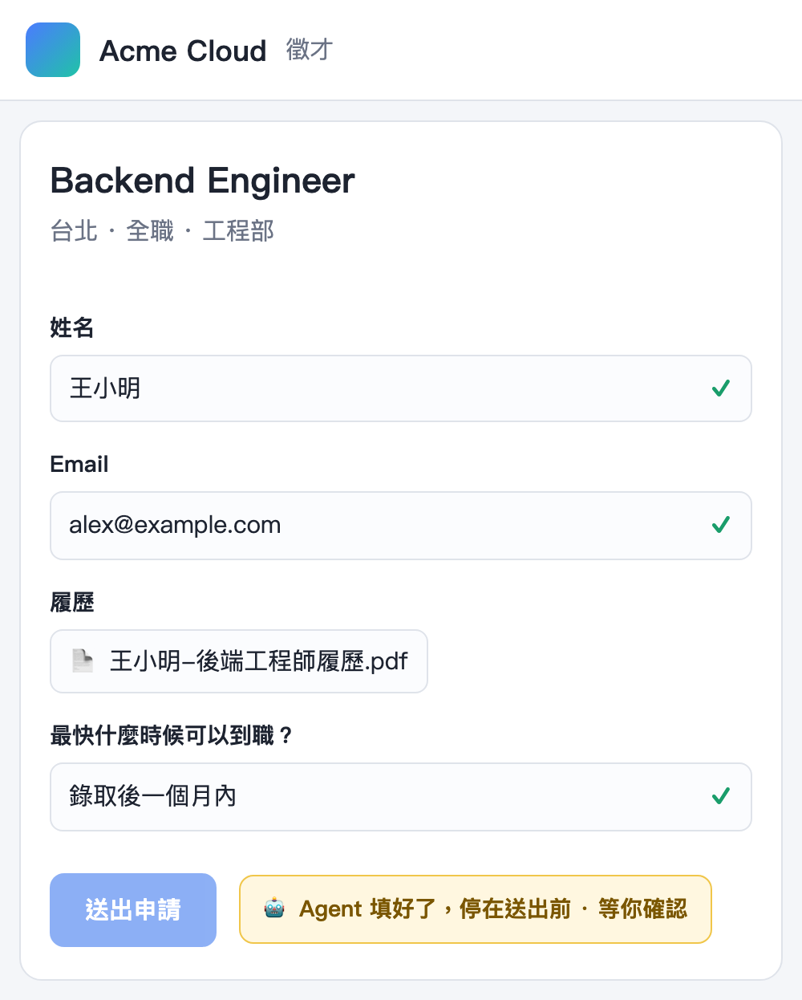
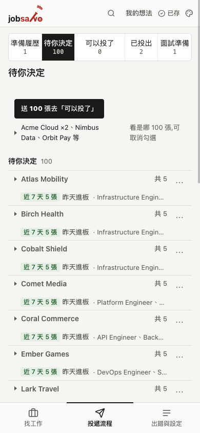

# jobsalvo

**精準求職**

找缺、判斷對不對味、挑履歷、填申請表、查應徵進度、準備面試都交給 AI agent。只支援 macOS。

你對每張職缺的表態(喜歡、普通、差一點、不喜歡)和理由會整理成「你的喜好」,下一輪找缺、判斷照它更準。每一份申請都停在送出前,你確認了才送。



## 流程

看板左邊分三組,一張職缺照這個順序往下走:

```
找工作      新職缺 → 表態(喜歡 / 普通 / 差一點 / 不喜歡)
投遞流程    準備履歷 → 待你決定 → 可以投了 → 已投出 → 面試準備
出錯與設定  出錯了、已移除、設定
```

- **找新職缺**:三種找法——更深(多找你喜歡過的那類)、更廣(你還沒看過、履歷做得來的職能)、指定方向(照你寫的方向);也可以貼自己找到的職缺網址,或在卡片、公司列上點「找類似的」「找這家更多」。
  程式先清掉重複的、職稱撞到「一定不要」的,agent 再逐張拿 JD 對照你對相似舊卡的表態,決定要不要送到你眼前。每輪預設最多 15 分鐘(可改,0 = 不限)。
  有詐騙徵兆的(要先繳錢、要敏感個資)不送;看起來掛著沒在招人的幽靈職缺照樣送,但卡上標出來。
- **新職缺**:一張一張看,卡上有為什麼適合你、公司在做什麼、門檻,每一項都標出是 agent 說的。按「喜歡」就送去準備履歷;「差一點」是條件還差一點,跟喜歡一樣會拿來找類似的。
- **準備履歷**:agent 讀 JD,從你勾選的履歷裡挑一份、挑語言,程式建好要寄的檔案。
- **待你決定**:通過投遞前驗收的卡可以一次全部送去「可以投了」;要先客製、或想自己看一下的取消勾選,留在這裡一張一張決定。客製可以交給 agent,或「這張用自己的檔」。
- **可以投了**:agent 在它專用的瀏覽器(ego lite,跟你的瀏覽器分開、每張卡一個工作區,不搶你的畫面)裡把表單每一題填好、停在送出前。你在卡上看它填好的那一頁(手機也行),卡在登入或驗證時可以接手那一頁。
  按「確認送出」後,同一隻 agent 才在同一頁送出,8 秒內可以復原。**程式不會自動送出。**
- **已投出**:agent 在自己的瀏覽器搜尋信箱與應徵紀錄頁,程式讀它開著的每個分頁並核對引用,照證據把卡記成等回音、面試中、Offer、沒錄取(可復原)。頁上也統計各份履歷、語言、類別的回音率。
- **面試準備**:卡記成「面試中」就出現在這裡。每一場有自己的題目,另有每場都帶的共有題和題庫;題目、出處、面試時間都在網頁上改,可以預覽、匯出面試資料。
- **自動流程**(預設全開):按「喜歡」就開始準備、準備好自動進「可以投了」、自動填表、每天 09:00 查應徵進度;都停在送出前。
- agent 做不到、要你本人處理的事(登入、驗證碼)會出現在每一頁最上面的「回報」;頁面打不開之類的卡收在「出錯了」,可以放回原處。

每一種會派 agent 的工作跑著時都有暫停、繼續、停止。找新職缺按停止會先收工,已經找到的收下,收工中再按一次才強制停;其他的按停止直接停,已寫進卡上的照樣留著。沒跑成的旁邊有「看紀錄」。

<p>
  
  
</p>

## 權限與風險

程式交給 agent 的所有工作都經 `tools/agent_run.py` 執行:Claude Code 跳過權限詢問(`--dangerously-skip-permissions`),Codex 使用沒有檔案與網路沙箱限制的 `danger-full-access`,Command Code 用 `--yolo` 允許不經確認寫檔和執行 shell 指令;網頁工作另用 `--tools-all` 啟用 headless 預設停用的工具。職缺頁可能藏著影響 agent 的指令;agent 可能因此在你的帳號權限內執行指令、讀寫檔案或連網。

降低風險:用另一個 macOS 使用者帳號跑 jobsalvo,只在那個帳號放這套流程需要的資料和登入狀態,不要用存有私人檔案和其他重要登入狀態的日常帳號。

## 需要什麼

- macOS、git(沒有的話跑 `xcode-select --install`)。
- 至少一個裝好、登入好的 agent:Codex CLI(`codex`)、Claude Code(`claude`)或 Command Code(`command-code`)。環境檢查只讀本機的登入紀錄,不送請求、不查額度。
- 三種都能找缺、判斷、準備履歷。這些工作 agent 不操作瀏覽器:網頁由程式讀,先直接抓、再走閱讀代理,要跑 JS 才有字的頁用 agent 的瀏覽器讀;要登入才看得到的頁會回報給你。
- 填表與查應徵進度要會操作瀏覽器的 agent:Codex 或 Claude Code(Command Code 不能用瀏覽器),只裝其中一種就好;同一時間只讓一個 agent 用瀏覽器(設定裡只能勾一個「用它操作 ego」)。
  還要一個 agent 專用的瀏覽器 ego lite(裝一個 app、匯入一次),步驟見 [設定幫你填表用的瀏覽器](docs/agent-browser.md)。沒有時仍可找缺。

Python 和套件由 [uv](https://docs.astral.sh/uv/)(管 Python 和套件的工具)裝在程式資料夾的 `.venv`,版本鎖在 `uv.lock`;安裝程式會在沒有 uv 時自動裝。

## 開始用

```bash
bash -o pipefail -c 'curl -fsSL https://raw.githubusercontent.com/GongYuanCaiJi/jobsalvo/main/tools/install.sh | bash'
```

程式裝在 `~/Applications/jobsalvo`,你的資料放在 `~/jobsearch`,看板開在 http://127.0.0.1:8899。
要換地方(例如同一台電腦再裝一份試用),在指令前面加 `JOBSALVO_APP_DIR=…`、`JOBSALVO_HOME=…`、`JOBSALVO_PORT=…`;
新建的資料夾有自己的暫存資料夾和 agent 瀏覽器連線紀錄,不會互相踩;給的埠記在那個資料夾的設定裡(`board.port`),開機自動啟動、重跑安裝都用它。

安裝程式依序:下載程式(已裝過就 `git pull --ff-only`)、裝 uv 並 `uv sync`、建資料夾(agent 清單照這台電腦裝了、登入了哪個 CLI 來定)、跑環境檢查(必要項沒過就列出處理方式並停止)、啟動看板並打開瀏覽器。
第一次打開會落在「設定」;「開始前」只要求上傳一份履歷。設定頁的「環境檢查」顯示同一份檢查結果。

安裝程式啟動的看板在背景跑、只開在本機,重開機就不在了。要開機自動啟動,到設定的「其他」打開:安裝程式起的那個看板會自己關掉,
大約半分鐘後由開機自動啟動起的接手(重整頁面就好);這樣起的看板有裝 [Tailscale](https://tailscale.com/) 時也開在 Tailscale 位址,手機才連得到。

停止、重新啟動(資料夾不在 `~/jobsearch` 的換成你的):

| 看板是誰起的 | 停止 | 重新啟動 |
|---|---|---|
| 安裝程式 | `kill "$(cat ~/jobsearch/.jobsalvo-server.pid)"` | 先停止,再跑一次安裝指令 |
| 開機自動啟動 | 設定的「其他」關掉開機自動啟動 | 按「更新」後會自己重新啟動;要手動就在終端機跑 `cd ~/Applications/jobsalvo && JOBSALVO_HOME=~/jobsearch uv run python tools/install_service.py` |

想先看看長什麼樣子(假資料,按鈕跑的是假流程):

```bash
cd ~/Applications/jobsalvo
uv run python tools/demo.py /tmp/demo.html
uv run python tools/board_server.py --state /tmp/demo.html --port 8898
```

## 設定

設定頁分四組:

| 組 | 有什麼 |
|---|---|
| 你的資料 | 你的履歷(每份各語言一個檔,可附 CSS,寫一句「什麼時候用」;履歷有哪些語言、你看得懂的語言)、你的附件(作品集、求職信,勾選能搭哪幾份履歷)、改履歷的規則(每份履歷與附件可以各指定一份,留白用產品附的通用規則)、環境檢查 |
| 找缺與判斷 | 找缺(職稱一出現就不送的「一定不要」、要交給判斷看的「要小心」)、找缺與判斷的做法(每一份都可以拿預設改一份自己的)、你的喜好(分「使用者自訂」和「Agent 假設」,agent 不改你寫的)、分類(類別與標籤,可以讓 agent 照你的履歷和表態建議)、公司別名 |
| 投遞 | 自動流程(每一步各自開關、最多停幾張等你確認送出、同時填幾張)、填表做法(幫你填表時原文交給 agent)、網站筆記、查應徵進度(沒下文的天數、信箱網址) |
| Agent 與系統 | Agent 與瀏覽器(agent 清單由上往下試,可選執行環境、速度、思考強度;只能勾一個「用它操作 ego」;檢查 ego)、其他(資料夾、開機自動啟動、版本與更新、版本紀錄) |

## 更新

設定的「其他」會顯示程式版本;GitHub 上的 main 有新的,就會出現「更新到 …」,按一下會快轉到最新的 main 並 `uv sync`。開機自動啟動時可以打開自動更新(每小時檢查)。
看板是開機自動啟動的會自己重啟;不是的話照上面「停止、重新啟動」重新啟動看板(只重跑安裝指令不會重啟還在跑的看板)。
程式資料夾切在別的分支、或有沒提交的變更時,按鈕只說原因、不動,請自己用 git。

## 移除

```bash
bash ~/Applications/jobsalvo/tools/uninstall.sh
```

停掉看板、移除開機自動啟動、清掉快取和暫存、刪掉程式資料夾(含 `.venv`)。你的求職資料夾留著;要一起刪加 `--data`(刪了拿不回來)。

## 程式與資料分開

程式資料夾不放你的任何資料。資料夾的位置依序看:`JOBSALVO_HOME`、目前目錄往上找到的第一個 `jobsalvo.json`、目前目錄。裡面有:

```
jobsalvo.json      設定(設定頁寫的,也可以手改,一般的 JSON)
board.html         看板與全部職缺、你的標記
prefs.md  preference-note.md  apply-rules.md   表態原話、你的喜好、填表做法
resume/            上傳的履歷、附件、CSS
custom/            改履歷的規則(skills/)、每張卡自己的檔與客製版
card-summaries/    每個職缺研究到什麼
prepare/           準備履歷時 agent 的判斷(fill.json)
ship/              要寄的檔案:<卡名>-<網址 sha1 前 12 碼>/
.research/         找缺每一輪的紀錄
```

看板每次存檔後,程式會在資料夾的本機 Git 版本庫記一筆(不設定遠端),設定頁「版本紀錄」看得到。找缺或分類建議讀不出上傳的履歷時,可以貼上文字,存在 `.resume-paste.md`。

## 履歷

- Markdown 原稿由 agent 的瀏覽器(ego)排成 PDF,有上傳 CSS 就用它,沒有就用瀏覽器預設樣式(產品不附版型);PDF 原樣使用。排出來超過一頁時設定頁會提醒。
- **要寄的檔案** `ship/<卡名>-<id>/`:履歷和附件的個別檔、程式產的合併 PDF(`merged.pdf`),以及 `ship.json`(`variant`、`lang`、`files`、`merged`);原稿或 CSS 改了會重做。
- **客製**:「待你決定」和「可以投了」的卡可以一次選多份履歷或附件交給同一個 agent,照各檔的改履歷的規則修改。
  輸出要通過 PDF 與頁數檢查,等你看過收下才替換要寄的檔案;退回重寫或檢查中不能送出。直接上傳自己的 PDF 算已收下。
- 面試題庫的正本在看板,資料夾的 `interview-bank.md` 是單向匯出。agent 寫題目、出處、面試時間一律用 `tools/iv.py`,格式與規則見 [docs/interview-bank.md](docs/interview-bank.md)。

## 開發

```bash
uv run python -m unittest discover -s tests
```

每支程式最上面的說明就是它的規格;要改規則,改程式,不要只改文件。
